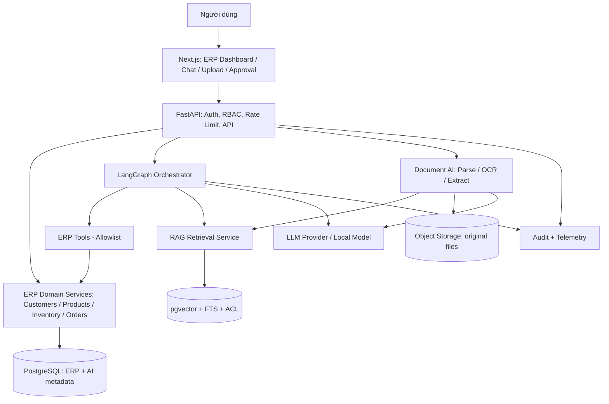
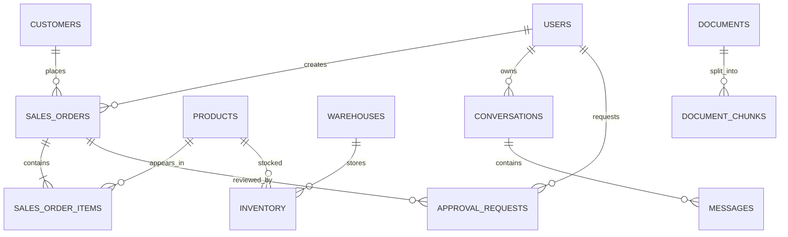
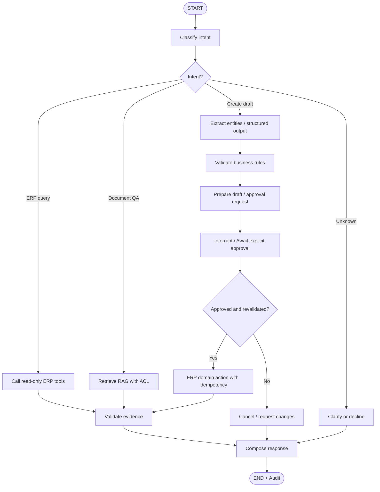
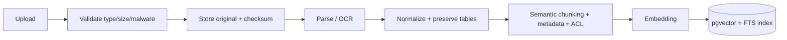
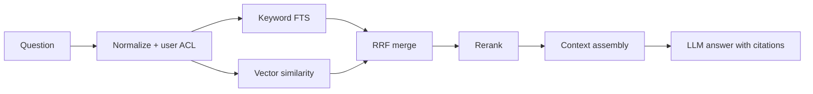
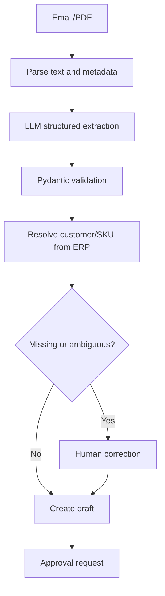

# ERP AI Copilot — Thiết kế kỹ thuật và lộ trình xây dựng MVP

> **Phiên bản:** 1.0 · **Ngày:** 11/10/2026 · **Phạm vi:** ERP demo xây mới, không phụ thuộc ERP có sẵn · **Ngôn ngữ:** Tiếng Việt

## 1. Executive summary

**Mục tiêu:** Xây dựng ERP demo tích hợp trợ lý AI hội thoại có thể (1) truy vấn dữ liệu bán hàng, khách hàng, sản phẩm và tồn kho; (2) hỏi đáp tài liệu bằng RAG kèm nguồn; (3) đọc email/tài liệu đặt hàng, trích xuất dữ liệu và tạo **đơn hàng nháp** qua workflow có xác nhận.

**Nguyên tắc:** LLM không phải nguồn sự thật nghiệp vụ, không truy cập database bằng quyền ghi và không được tự phê duyệt hành động. Các ERP Domain Services chịu trách nhiệm xác thực, tính toán, transaction, phân quyền và audit.

**Phạm vi MVP:** Sales, Customers, Products, Inventory, Document Center, AI Chat, Approval Inbox. Chưa làm kế toán tổng hợp, sản xuất, payroll, multi-agent tự trị hoặc fine-tuning.

**Thời gian tham chiếu:** 16 tuần / 8 sprint, mỗi sprint 2 tuần; nhóm 3–5 người. Với 1 người, cần thu hẹp phạm vi hoặc tăng thời gian.

## 2. Yêu cầu chức năng và tiêu chí thành công

| ID | Use case | Đầu vào | Kết quả | Điều kiện nghiệm thu |
|---|---|---|---|---|
| UC-01 | Tra cứu ERP | “SKU-001 còn bao nhiêu hàng?” | Số lượng theo kho, thời điểm cập nhật | Đúng dữ liệu DB, không lộ dữ liệu ngoài quyền |
| UC-02 | Báo cáo doanh thu | “Doanh thu tháng 9?” | Metric và kỳ báo cáo rõ ràng | Đối chiếu được SQL/view chuẩn |
| UC-03 | Hỏi đáp tài liệu | “Quy định đổi trả là gì?” | Câu trả lời có citation | Citation đúng chunk/tài liệu và quyền truy cập |
| UC-04 | Email-to-draft | Email đặt hàng | Trích xuất khách, SKU, số lượng, ngày giao; tạo draft | Thiếu thông tin thì hỏi lại; không tự xác nhận |
| UC-05 | Phê duyệt | Bản nháp chờ duyệt | Phê duyệt/từ chối, audit | Đúng người, đúng payload/version; không ghi trùng |
| UC-06 | Phản hồi khách hàng | Email phàn nàn | Phân loại, trích xuất vấn đề | Không suy đoán mã đơn khi thiếu dữ liệu |

**Non-functional:** AuthN/AuthZ, audit trail, idempotency, structured logging, timeout, retry giới hạn, backup, migration, đánh giá chất lượng và chi phí model. Các mục tiêu latency/accuracy là **mục tiêu thiết kế**, không phải kết quả đã đo.

## 3. Kiến trúc tổng thể



### 3.1. Stack công nghệ

| Layer | Khuyến nghị | Ghi chú |
|---|---|---|
| Frontend | Next.js, TypeScript, Tailwind | Dashboard + Chat + Document Review + Approval |
| Backend | Python, FastAPI, Pydantic | Modular monolith |
| ORM / migration | SQLAlchemy 2.x, Alembic | Migrations versioned |
| Database | PostgreSQL + pgvector | Một hệ DB cho MVP; schema tách biệt |
| Agent | LangGraph | State, routing, checkpoint, interrupt |
| LLM | API model có tool calling + structured output | Abstraction để đổi model; chọn sau benchmark |
| Embedding | Model đa ngôn ngữ hỗ trợ tiếng Việt | Số chiều vector phải khớp DB |
| RAG | Hybrid FTS + vector, reranker tùy chọn | Metadata và ACL bắt buộc |
| Document | Docling / parser định dạng + OCR khi cần | Parse PDF, DOCX, EML |
| Job queue | Redis + worker (khi cần) | OCR/indexing bất đồng bộ |
| Object storage | MinIO hoặc S3-compatible | File gốc; không lưu file lớn trong DB |
| Monitoring | OpenTelemetry, Langfuse | Trace, latency, cost, lỗi |
| Runtime | Docker Compose | Kubernetes chỉ khi có nhu cầu |

### 3.2. Boundary và trách nhiệm

- **UI:** hiển thị dữ liệu, nhập prompt, chỉnh sửa extracted fields, xác nhận hành động; không tự quyết định quyền.
- **API/Auth:** lấy danh tính từ session/JWT đáng tin cậy; áp dụng RBAC, tenant scope, rate limit.
- **ERP services:** nguồn sự thật cho giá, tồn kho, trạng thái đơn, transaction và validation.
- **Agent:** hiểu intent, chọn công cụ cho phép, tổng hợp câu trả lời; không sở hữu quyền đặc biệt.
- **RAG:** tìm tài liệu có quyền truy cập, trả chunk + citation; không dùng để thay số liệu giao dịch live.
- **Document AI:** tạo dữ liệu trích xuất có confidence/validation flags, không tự ghi đơn đã xác nhận.

## 4. Data model và database schema

### 4.1. ERD logic



### 4.2. Bảng chính

| Schema.table | Trường quan trọng | Ràng buộc / lưu ý |
|---|---|---|
| `erp.users` | id, email, password_hash, role_id, is_active | Email unique; demo vẫn cần auth |
| `erp.roles` | id, name | Permissions nên ở bảng riêng hoặc policy layer |
| `erp.customers` | id, code, name, email, status | code unique |
| `erp.products` | id, sku, name, unit_price, is_active | NUMERIC, sku unique |
| `erp.warehouses` | id, code, name | code unique |
| `erp.inventory` | product_id, warehouse_id, quantity_on_hand, quantity_reserved | Composite PK; kiểm tra reserved <= on_hand |
| `erp.sales_orders` | id, order_number, customer_id, status, total_amount, created_by, version | `draft/pending_approval/confirmed/cancelled` |
| `erp.sales_order_items` | id, order_id, product_id, quantity, unit_price, line_total | quantity > 0; giá snapshot tại thời điểm lập đơn |
| `ai.documents` | id, filename, mime_type, storage_key, checksum, owner_id, status, version | Trạng thái ingest; nguồn và quyền |
| `ai.document_chunks` | id, document_id, chunk_index, content, metadata, embedding | Embedding dimension theo model |
| `ai.conversations` | id, user_id, title, created_at | User ownership |
| `ai.messages` | id, conversation_id, role, content, created_at | Audit/retention policy |
| `ai.agent_runs` | id, conversation_id, status, model, latency_ms, token_usage | Trace metadata |
| `erp.approval_requests` | id, action_type, target_id, payload, payload_hash, status, requested_by, approved_by, expires_at | Approval versioned; immutable payload |
| `erp.audit_logs` | id, actor_id, action, resource_type, resource_id, result, created_at | Append-only policy |
| `erp.idempotency_keys` | key, actor_id, request_hash, response_ref, created_at | Unique theo actor/scope |

### 4.3. SQL nền tảng (trích đoạn)

```sql
CREATE EXTENSION IF NOT EXISTS pgcrypto;
CREATE EXTENSION IF NOT EXISTS vector;
CREATE SCHEMA IF NOT EXISTS erp;
CREATE SCHEMA IF NOT EXISTS ai;

CREATE TABLE erp.customers (
  id UUID PRIMARY KEY DEFAULT gen_random_uuid(),
  code VARCHAR(30) NOT NULL UNIQUE,
  name TEXT NOT NULL,
  email TEXT,
  status TEXT NOT NULL DEFAULT 'active'
    CHECK (status IN ('active', 'inactive'))
);

CREATE TABLE erp.products (
  id UUID PRIMARY KEY DEFAULT gen_random_uuid(),
  sku VARCHAR(50) NOT NULL UNIQUE,
  name TEXT NOT NULL,
  unit_price NUMERIC(14,2) NOT NULL CHECK (unit_price >= 0),
  is_active BOOLEAN NOT NULL DEFAULT true
);

CREATE TABLE erp.warehouses (
  id UUID PRIMARY KEY DEFAULT gen_random_uuid(),
  code TEXT NOT NULL UNIQUE,
  name TEXT NOT NULL
);

CREATE TABLE erp.inventory (
  product_id UUID NOT NULL REFERENCES erp.products(id),
  warehouse_id UUID NOT NULL REFERENCES erp.warehouses(id),
  quantity_on_hand INTEGER NOT NULL DEFAULT 0 CHECK (quantity_on_hand >= 0),
  quantity_reserved INTEGER NOT NULL DEFAULT 0 CHECK (quantity_reserved >= 0),
  PRIMARY KEY (product_id, warehouse_id),
  CHECK (quantity_reserved <= quantity_on_hand)
);

CREATE TABLE erp.sales_orders (
  id UUID PRIMARY KEY DEFAULT gen_random_uuid(),
  order_number TEXT NOT NULL UNIQUE,
  customer_id UUID NOT NULL REFERENCES erp.customers(id),
  status TEXT NOT NULL DEFAULT 'draft'
    CHECK (status IN ('draft','pending_approval','confirmed','cancelled')),
  total_amount NUMERIC(14,2) NOT NULL DEFAULT 0 CHECK (total_amount >= 0),
  created_by UUID NOT NULL,
  version INTEGER NOT NULL DEFAULT 1,
  created_at TIMESTAMPTZ NOT NULL DEFAULT now()
);

CREATE TABLE erp.sales_order_items (
  id UUID PRIMARY KEY DEFAULT gen_random_uuid(),
  order_id UUID NOT NULL REFERENCES erp.sales_orders(id) ON DELETE CASCADE,
  product_id UUID NOT NULL REFERENCES erp.products(id),
  quantity INTEGER NOT NULL CHECK (quantity > 0),
  unit_price NUMERIC(14,2) NOT NULL CHECK (unit_price >= 0),
  line_total NUMERIC(14,2) GENERATED ALWAYS AS (quantity * unit_price) STORED
);

CREATE TABLE ai.documents (
  id UUID PRIMARY KEY DEFAULT gen_random_uuid(),
  filename TEXT NOT NULL,
  mime_type TEXT,
  storage_key TEXT NOT NULL,
  checksum TEXT NOT NULL,
  owner_id UUID,
  access_scope TEXT NOT NULL DEFAULT 'private',
  status TEXT NOT NULL DEFAULT 'uploaded',
  version INTEGER NOT NULL DEFAULT 1,
  created_at TIMESTAMPTZ NOT NULL DEFAULT now()
);

-- VECTOR(1024) chỉ là ví dụ; thay theo embedding model đã chọn.
CREATE TABLE ai.document_chunks (
  id UUID PRIMARY KEY DEFAULT gen_random_uuid(),
  document_id UUID NOT NULL REFERENCES ai.documents(id) ON DELETE CASCADE,
  chunk_index INTEGER NOT NULL,
  content TEXT NOT NULL,
  metadata JSONB NOT NULL DEFAULT '{}'::jsonb,
  embedding VECTOR(1024),
  UNIQUE (document_id, chunk_index)
);
CREATE INDEX idx_document_chunks_metadata ON ai.document_chunks USING GIN (metadata);
```

**Chưa bao gồm toàn bộ DDL:** `users`, `roles`, `approval_requests`, `audit_logs`, `idempotency_keys`, `messages`, `conversations`, index vector, RLS policies và reporting views phải được bổ sung qua Alembic migration. Không chạy trực tiếp schema ví dụ làm production migration hoàn chỉnh.

### 4.4. Business invariants

1. Tổng tiền đơn hàng = tổng dòng hàng, tính lại phía server trong transaction.
2. Giá bán lấy từ bảng giá hợp lệ/giá snapshot; không tin giá do LLM sinh.
3. `available = on_hand - reserved`; khi xác nhận/giữ hàng cần row locking hoặc optimistic concurrency.
4. Trạng thái đơn hàng chỉ chuyển theo state machine được phép.
5. Tạo đơn từ email mặc định `draft`, không tự động `confirmed`.
6. Ghi transaction và audit đồng bộ; xử lý side effects ngoài DB qua outbox nếu cần.
7. Mọi query phải bị giới hạn bởi quyền/tenant ở service layer hoặc RLS.

## 5. API design

**Prefix:** `/api/v1`; OpenAPI tự sinh qua FastAPI. Auth bằng OIDC/JWT hoặc session bảo mật; demo local có thể dùng login nội bộ nhưng không được lấy `user_id` từ prompt.

| Method | Endpoint | Mục đích | Quyền |
|---|---|---|---|
| POST | `/auth/login` | Đăng nhập demo | Public + rate limit |
| GET | `/customers` | Danh sách/tra cứu khách | `customer:read` |
| GET | `/products` | Tra cứu SKU | `product:read` |
| GET | `/inventory?sku=...` | Tồn kho theo kho | `inventory:read` |
| GET | `/sales-orders` | Danh sách đơn | `order:read` |
| POST | `/sales-orders/drafts` | Tạo draft | `order:create_draft` |
| GET | `/sales-orders/{id}` | Chi tiết đơn | `order:read` |
| POST | `/documents` | Upload tài liệu | `document:upload` |
| GET | `/documents/{id}` | Trạng thái tài liệu | `document:read` |
| POST | `/chat` | Chat Agent | Authenticated |
| GET | `/conversations/{id}` | Lịch sử chat | Conversation owner |
| GET | `/approvals` | Hộp thư phê duyệt | `approval:read` |
| POST | `/approvals/{id}/approve` | Phê duyệt | `approval:approve` |
| POST | `/approvals/{id}/reject` | Từ chối | `approval:approve` |

### 5.1. Chat contract

```json
{
  "conversation_id": null,
  "message": "Kiểm tra tồn kho SKU-001",
  "attachments": [],
  "response_mode": "sync"
}
```

```json
{
  "conversation_id": "<uuid>",
  "run_id": "<uuid>",
  "status": "completed",
  "answer": "SKU-001 còn 120 đơn vị khả dụng.",
  "sources": [{"type": "erp", "resource": "inventory", "sku": "SKU-001"}],
  "actions": [],
  "requires_confirmation": false
}
```

Với streaming dùng `text/event-stream`, sự kiện gợi ý: `run_started`, `message_delta`, `tool_started`, `tool_completed`, `approval_required`, `run_completed`, `run_failed`. Không gửi chain-of-thought nội bộ.

### 5.2. Order draft contract

```json
{
  "customer_code": "CUS-0001",
  "items": [{"sku": "SKU-001", "quantity": 20}],
  "requested_delivery_date": "2026-10-20",
  "source_document_id": null
}
```

Yêu cầu idempotency header cho write endpoints, ví dụ `Idempotency-Key`. Backend kiểm tra khách hàng, SKU, số lượng, giá, quyền; trả `draft_id` và danh sách cảnh báo. Phê duyệt là endpoint riêng với kiểm tra payload hash/version và transaction.

### 5.3. Error contract

```json
{"error":{"code":"PRODUCT_NOT_FOUND","message":"Không tìm thấy SKU-999","request_id":"req-001"}}
```

Mã lỗi: `UNAUTHORIZED`, `FORBIDDEN`, `VALIDATION_ERROR`, `NOT_FOUND`, `INSUFFICIENT_STOCK`, `APPROVAL_REQUIRED`, `CONFLICT`, `RATE_LIMITED`, `MODEL_UNAVAILABLE`.

## 6. LangGraph orchestration

### 6.1. Agent state

```python
from typing import Any, Literal
from typing_extensions import TypedDict

class ERPAgentState(TypedDict, total=False):
    user_id: str  # injected from trusted auth context
    conversation_id: str
    request_id: str
    messages: list[Any]
    user_query: str
    intent: Literal['erp_query', 'document_qa', 'create_order_draft', 'unknown']
    entities: dict[str, Any]
    retrieved_context: list[dict[str, Any]]
    tool_results: list[dict[str, Any]]
    proposed_action: dict[str, Any] | None
    approval_id: str | None
    answer: str
    citations: list[dict[str, Any]]
    error: str | None
```

### 6.2. Graph đề xuất



**Node contracts:**

| Node | Input | Output | Quy tắc |
|---|---|---|---|
| `classify_intent` | query | intent, entities | Nếu mơ hồ, hỏi lại |
| `call_erp_tools` | intent + auth context | tool results | Allowlisted read-only tools |
| `retrieve_documents` | query + ACL | chunks, citations | Filter ACL trước generation |
| `extract_entities` | email/text | typed fields | Structured output + Pydantic |
| `validate_business_rules` | fields | validation/errors | Không để LLM quyết định quy tắc |
| `prepare_draft` | validated fields | draft + approval request | Không confirm |
| `request_approval` | immutable payload | paused workflow | LangGraph checkpoint/interrupt |
| `execute_action` | approved request | ERP result | Re-auth, revalidate, idempotency |
| `compose_response` | results | answer, citations | Không tự bịa dữ liệu |

### 6.3. Tool registry

- `get_customer(customer_code)`
- `get_product(sku)`
- `get_inventory(sku, warehouse_code?)`
- `get_sales_orders(customer_code?, date_range?, status?)`
- `get_revenue(metric_id, period)` — dùng semantic layer/reporting views.
- `search_knowledge(query)`
- `create_sales_order_draft(validated_payload)` — chỉ draft.
- `submit_draft_for_approval(draft_id)` — workflow có kiểm soát.

**Không triển khai `execute_arbitrary_sql(sql)` hoặc `confirm_order()` như tool tự do cho Agent.** Nếu mở rộng Text-to-SQL, chỉ dùng reporting views, read-only credentials, AST validation, statement timeout, row limit, allowlist và quyền hàng/cột.

### 6.4. Human-in-the-loop

1. Agent đề xuất action có payload chuẩn.
2. ERP service kiểm tra quyền, dữ liệu và tạo draft.
3. Tạo approval request chứa `payload_hash`, `draft_id`, `requester`, `expires_at`, `status`.
4. LangGraph checkpoint + interrupt; UI hiển thị nội dung cần duyệt.
5. Người có quyền bấm Approve/Reject trên request cụ thể.
6. Backend revalidate actor, trạng thái, version, giá/tồn kho; transaction + idempotency.
7. Ghi audit, resume graph theo `thread_id`, trả kết quả.

Lưu ý retry sau interrupt: side effects phải idempotent; không đặt write không an toàn ở node có thể bị replay.

## 7. RAG pipeline

### 7.1. Ingestion



**Metadata tối thiểu:** document_id, filename, source, owner/department, ACL, page/section, created_at, effective_date, version, checksum. Với tài liệu thay đổi: version, re-index, delete stale chunks.

**Chunking khởi đầu:** 400–800 tokens, overlap 60–100 tokens, nhưng cần benchmark. Giữ tiêu đề, bảng, trang và nguồn. OCR chỉ khi cần, không bắt buộc cho PDF có text.

### 7.2. Query



- Hybrid search quan trọng với SKU, mã đơn hàng, tên riêng.
- RRF + reranking là tùy chọn tối ưu, triển khai sau vector baseline.
- Truy xuất phải lọc quyền trước khi đưa nội dung vào LLM.
- Trả citation theo document_id, chunk_id, page/section; không tạo citation giả.
- Nếu không đủ bằng chứng, nói chưa tìm thấy thông tin thay vì suy đoán.
- Không dùng RAG cho số dư/tồn kho live; gọi ERP tools.

### 7.3. Document AI / Email-to-order



Ví dụ structured output:

```json
{
  "customer_name": "ABC",
  "document_type": "purchase_request",
  "items": [
    {"product_code": "SKU-001", "quantity": 20},
    {"product_code": "SKU-002", "quantity": 15}
  ],
  "requested_delivery_date": "2026-10-20",
  "unit_prices": null,
  "status": "requires_validation"
}
```

Không tự suy ra giá, mã đơn hoặc khách hàng nếu chưa đối chiếu; `null` và human review là kết quả hợp lệ.

## 8. Frontend UX / desktop mockup

Phong cách: **tối giản, hiện đại, nền trắng, xanh dương tươi**, sidebar rõ ràng, ô tìm kiếm/AI chat lớn ở giữa, CTA xanh. Bốn màn hình MVP:

1. **Home / AI Copilot:** Sidebar (Trang chủ, Bán hàng, Kho, Tài liệu, AI Copilot, Phê duyệt); hero chat input; gợi ý câu hỏi; CTA “Bắt đầu ngay”; KPI demo có nhãn dữ liệu mô phỏng.
2. **ERP Dashboard:** Khách hàng, sản phẩm, tồn kho, đơn hàng; lọc và phân trang.
3. **Document Review:** Upload, trạng thái OCR/parse, bảng extracted fields, sửa và xác nhận.
4. **Approval Inbox:** Danh sách chờ duyệt, diff dữ liệu, người yêu cầu, thời hạn, nút Approve/Reject.

Yêu cầu UX: hiển thị trạng thái tool đang chạy, nguồn trích dẫn, lỗi rõ ràng, phân biệt draft với confirmed, không hiển thị dữ liệu demo như dữ liệu thật.

## 9. Repository structure

```text
erp-ai-copilot/
├── frontend/                  # Next.js, TypeScript
├── backend/
│   ├── app/
│   │   ├── api/              # FastAPI routers
│   │   ├── auth/             # identity, RBAC, policies
│   │   ├── core/             # config, errors, logging
│   │   ├── db/               # session, models, repositories
│   │   ├── erp/              # customer, product, inventory, sales services
│   │   ├── ai/
│   │   │   ├── agents/       # LangGraph state/nodes/graph
│   │   │   ├── tools/        # allowlisted ERP tools
│   │   │   └── prompts/      # versioned prompts
│   │   ├── rag/              # ingest, chunk, embed, retrieve, rerank
│   │   ├── document_ai/      # parse, extract, validate
│   │   └── main.py
│   ├── alembic/
│   ├── tests/
│   └── pyproject.toml
├── scripts/seed_demo_data.py
├── data/sample_documents/
├── evals/                     # golden datasets + evaluation scripts
├── infrastructure/            # Docker, config, telemetry
├── docker-compose.yml
├── .env.example
└── README.md
```

## 10. Lộ trình chi tiết 16 tuần / 8 sprint

| Sprint | Tuần | Công việc chi tiết | Deliverable | Exit criteria |
|---|---|---|---|---|
| S1 Foundation | 1–2 | Repo, Docker, DB, ERD, migrations, auth skeleton, seed generator, API contract | Running local stack + DB demo | Một lệnh chạy DB; seed/migration repeatable |
| S2 ERP Core | 3–4 | CRUD/READ customers/products/inventory/orders, reporting views, domain validations, tests | ERP API v1 | Tests pass; order totals correct; auth enforced |
| S3 RAG Ingestion | 5–6 | Upload, storage, parser, OCR, chunk, metadata, embedding, index | Document ingestion service | File ingest/status/re-index/delete hoạt động |
| S4 RAG Retrieval | 7–8 | Hybrid retrieval, citation, ACL, RAG Q&A, baseline evaluation | RAG assistant | Có citations; benchmark retrieval; ACL test |
| S5 Agent | 9–10 | LangGraph state, intent router, tool calling, checkpoint, errors, tracing | Conversational ERP Agent | Trả lời truy vấn tồn kho/đơn hàng/tài liệu |
| S6 Document AI | 11–12 | Email extraction, structured output, entity resolution, draft service, approval request | Email-to-draft | Tạo draft đúng; thiếu dữ liệu thì hỏi lại |
| S7 Frontend + HITL | 13–14 | Chat, dashboard, document review, approval inbox, resume graph, idempotency | Usable MVP UI | End-to-end email → draft → approval |
| S8 Hardening | 15–16 | Eval, RBAC/prompt-injection tests, load, observability, docs, demo | Release candidate | Security checklist, benchmark, demo reproducible |

### 10.1. Phân công nhân sự gợi ý

- **Backend/ERP engineer:** schema, services, auth, API, transaction, migration.
- **AI engineer:** LangGraph, LLM, RAG, Document AI, evaluation.
- **Frontend engineer:** Next.js, Chat, Dashboard, Approval, Document Review.
- **QA/DevOps (part-time):** CI, integration tests, security tests, Docker, monitoring.
- **Product/Business analyst (part-time):** business rules, acceptance cases, golden dataset.

### 10.2. Mốc demo theo tuần

- **Tuần 2:** DB + seed + API health + màn hình khung.
- **Tuần 4:** Tra cứu khách hàng, SKU, tồn kho qua REST.
- **Tuần 6:** Upload và index tài liệu.
- **Tuần 8:** Hỏi đáp chính sách có citation.
- **Tuần 10:** Chat hỏi tồn kho/đơn hàng qua tools.
- **Tuần 12:** Email → trích xuất → draft.
- **Tuần 14:** Người dùng duyệt draft trên UI.
- **Tuần 16:** Benchmark + demo đầy đủ + release notes.

## 11. Kế hoạch thực thi từng bước

### Step 1 — Environment

- Tạo Git repo, `.gitignore`, `.env.example`, lint/format/test hooks.
- Docker Compose: PostgreSQL pgvector; Redis và MinIO chỉ khi cần.
- Thiết lập migrations Alembic; tách dev/test databases.
- Seed 30–100 customers, 50–200 products, 2–5 warehouses, 200–1.000 orders và 30–100 documents giả lập.

### Step 2 — ERP backend

- Viết Pydantic DTOs + SQLAlchemy models + repositories.
- Services `get_inventory`, `get_customer`, `list_orders`, `create_order_draft`.
- Tính toán server-side, transaction, concurrency control.
- Test edge cases: SKU không tồn tại, số lượng âm, hàng thiếu, trạng thái không hợp lệ.

### Step 3 — RAG

- Upload validation, object storage, parser, chunking.
- Chọn embedding model và tạo index tương thích số chiều.
- Xây vector baseline trước, sau đó FTS/RRF/rerank.
- Trả citation; kiểm thử ACL và tài liệu phiên bản cũ.

### Step 4 — Agent

- LLM client abstraction, tool schemas, prompt versioning.
- Intent routing, ERP tools, RAG tool, graph state, checkpoints.
- Error/timeout handling; không cho tool chạy SQL tùy ý.
- Test tool selection, multi-turn follow-up, hallucination, ambiguity.

### Step 5 — Document automation

- Parse EML/PDF; extract typed fields.
- Đối chiếu SKU/customer và cảnh báo field thiếu.
- Create draft; approval record + hash/version.
- Human confirmation; revalidation; idempotent write; audit.

### Step 6 — UI và release

- Desktop mockup: sidebar, search/chat lớn, CTA xanh, dashboard cards.
- Tích hợp SSE hoặc sync chat; document review và approval.
- CI: lint, unit, integration, security regression, eval smoke tests.
- Docker deployment, logs, monitoring, README, demo script.

## 12. Testing & evaluation

### 12.1. Bộ benchmark

Tạo **200–500 test cases** có golden answer/expected tool/expected policy; chia train/dev/test (không tối ưu prompt trên tập test cuối cùng). Các nhóm:

- Truy vấn tồn kho, khách hàng, đơn hàng, doanh thu.
- Câu hỏi tài liệu có/không có đáp án, có dấu/không dấu.
- Email đặt hàng đầy đủ, thiếu trường, mâu thuẫn.
- Truy vấn nhiều bước, lỗi tool, timeout.
- Prompt injection trong email/PDF và yêu cầu vượt quyền.
- Duplicate submission, concurrent approval, expired request.

### 12.2. Metrics mục tiêu (chưa đo)

| Module | Metrics | Mục tiêu MVP ban đầu |
|---|---|---|
| Intent | Macro F1 | ≥ 0.90 |
| RAG retrieval | Recall@5 | ≥ 0.90 |
| RAG answer | Groundedness/citation accuracy | ≥ 0.95 |
| Document extraction | Field-level F1 | ≥ 0.95 trường trọng yếu |
| Agent | Task success | ≥ 0.90 |
| Text-to-SQL (nếu có) | Execution + semantic accuracy | ≥ 0.85 |
| Security | Unauthorized writes/leaks trong test suite | 0 |
| Latency | P95 simple query | Mục tiêu ≤ 8 giây, điều chỉnh theo hạ tầng |

Phải lưu **dataset version, model version, prompt version, latency, tokens, cost, tool trace, test result** để so sánh giữa các lần thay đổi.

## 13. Rủi ro quan trọng và biện pháp giảm thiểu

| Rủi ro | Hậu quả | Biện pháp |
|---|---|---|
| Hallucination | Số liệu/đơn hàng sai | Ground answers in ERP tools; citations; abstention |
| Prompt injection từ email/PDF | Vượt quyền hoặc lộ dữ liệu | Treat documents as untrusted; allowlisted tools; policy checks |
| LLM ghi DB trực tiếp | Hỏng giao dịch | Domain API only; separate DB credentials |
| Lộ dữ liệu giữa người dùng | Rò rỉ thông tin | RBAC/tenant filter/RLS; authorization tests |
| Duplicate writes | Đơn hàng trùng | Idempotency keys, unique constraints, transaction |
| Race condition tồn kho | Bán vượt tồn | Lock/optimistic concurrency; revalidate on approval |
| RAG trả tài liệu cũ | Sai chính sách | Version/effective_date filters; re-index/delete |
| OCR/trích xuất sai | Đơn sai | Pydantic + ERP lookup + human review |
| Model/embedding thay đổi | Kết quả giảm chất lượng | Versioned prompts/models, eval regression, re-index strategy |
| Chi phí token tăng | Vượt ngân sách | Token budget, cache hợp lệ, limits, model routing |
| Demo không tái lập | Khó nghiệm thu | Seed deterministic, Docker, golden tests, runbook |

### 13.1. Security checklist bắt buộc

- [ ] Secrets không commit; credentials tách theo môi trường.
- [ ] AuthN/AuthZ trên mọi endpoint và tool; server lấy user context.
- [ ] Quyền đọc và quyền ghi phân tách; tài khoản LLM không có DB write.
- [ ] File upload kiểm tra MIME thực, dung lượng, malware và path traversal.
- [ ] ACL được lọc trước khi đưa chunk vào prompt.
- [ ] Approval gắn đúng actor, payload hash, version, expiry.
- [ ] Idempotency cho create/confirm; concurrency tests.
- [ ] Audit log, trace IDs, PII masking và retention policy.
- [ ] Prompt-injection regression suite; không tin instructions trong tài liệu.
- [ ] Backup/restore, migration rollback, error recovery.

## 14. Định nghĩa hoàn thành MVP (Definition of Done)

MVP được coi là hoàn thành khi:

1. Chạy được từ repository bằng hướng dẫn cài đặt và seed dữ liệu rõ ràng.
2. ERP dashboard xem được khách hàng, sản phẩm, tồn kho, đơn hàng.
3. Người dùng hỏi bằng tiếng Việt, Agent gọi đúng ERP tool và trả kết quả từ DB.
4. Upload tài liệu, RAG trả lời có citation đúng và chỉ trên tài liệu có quyền.
5. Email đặt hàng được trích xuất, đối chiếu ERP và tạo draft.
6. Draft chỉ được xác nhận sau phê duyệt hợp lệ; không tạo đơn trùng khi retry.
7. Có kiểm thử tự động, benchmark, logs/traces và báo cáo các hạn chế.
8. Có demo script end-to-end và tài liệu API/OpenAPI.

### 14.1. Demo end-to-end gợi ý

1. Mở Dashboard: xem số lượng sản phẩm và đơn hàng từ seed.
2. Chat: “SKU-001 còn bao nhiêu?” → kết quả theo kho.
3. Chat: “Chính sách giao hàng như thế nào?” → câu trả lời kèm nguồn PDF.
4. Upload email đặt 20 SKU-001 và 15 SKU-002 → trích xuất trường.
5. Chỉnh sửa trường thiếu → tạo order draft.
6. Mở Approval Inbox → kiểm tra giá/tồn kho → approve.
7. Mở đơn hàng đã xác nhận và audit trail.
8. Thử gửi lại cùng idempotency key → không tạo thêm đơn.

## 15. Ưu tiên sau MVP

**Phase 2:** Conversational BI với semantic layer, ticket từ customer feedback, workflow nhiều bước, multi-tenant, policy engine nâng cao, background ingestion lớn, performance tuning.

**Chưa nên ưu tiên:** Multi-agent tự trị, fine-tuning ngay từ đầu, microservices/Kubernetes phức tạp, cho LLM thực thi SQL tùy ý, tự động xác nhận giao dịch tài chính.

## 16. Tài liệu tham khảo chính thức nên theo dõi

- FastAPI: https://fastapi.tiangolo.com/
- LangGraph: https://docs.langchain.com/oss/python/langgraph/overview
- PostgreSQL: https://www.postgresql.org/docs/
- pgvector: https://github.com/pgvector/pgvector
- SQLAlchemy: https://docs.sqlalchemy.org/
- Alembic: https://alembic.sqlalchemy.org/
- OWASP LLM Top 10: https://genai.owasp.org/llm-top-10/
- OpenTelemetry: https://opentelemetry.io/docs/

---

**Khuyến nghị cuối:** Xây ERP Domain Services và bộ dữ liệu demo trước; sau đó RAG, Agent và Document AI; cuối cùng mới mở thao tác ghi có approval. Cách tiếp cận này giúp MVP dễ kiểm thử, có thể trình diễn, an toàn và đủ khả năng mở rộng.
