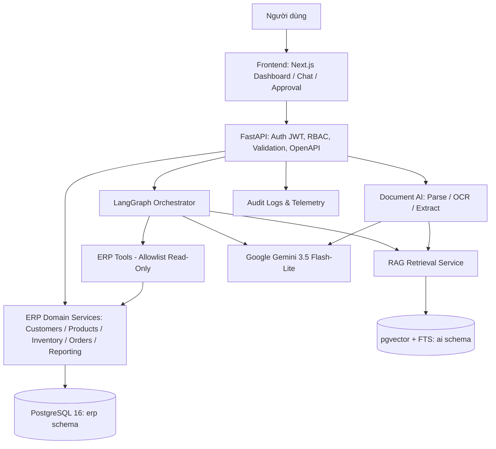

# 🚀 ERP AI Copilot (MVP)

> **Hệ thống ERP Demo tích hợp Trợ lý AI hội thoại thông minh**  
> Quản lý bán hàng, tồn kho, báo cáo doanh thu, hỏi đáp tài liệu RAG và trích xuất email tạo đơn hàng nháp với quy trình phê duyệt Human-In-The-Loop.

[](https://www.python.org/)
[](https://fastapi.tiangolo.com/)
[](https://github.com/pgvector/pgvector)
[](https://ai.google.dev/)
[](https://ai.google.dev/)
[](https://min.io/)
[](https://docs.langchain.com/oss/python/langgraph/)
[](https://www.docker.com/)

---

## 📌 1. Giới thiệu tổng quan

**ERP AI Copilot** là giải pháp kết hợp giữa hệ thống quản trị doanh nghiệp (ERP) tinh gọn và trợ lý trí tuệ nhân tạo (AI Copilot):
1. **Truy vấn ERP thời gian thực**: Tra cứu tức thì số lượng tồn kho theo kho (`on_hand`, `reserved`, `available`), thông tin khách hàng, sản phẩm, trạng thái đơn hàng.
2. **Báo cáo doanh thu chuẩn xác (UC-02)**: Đối chiếu doanh thu thực tế theo kỳ (tháng/năm) qua SQL/View chuẩn, loại bỏ đơn hủy.
3. **Tự động hóa Email-to-Draft**: Đọc email/PDF đặt hàng, trích xuất thực thể có cấu trúc và tạo **đơn hàng nháp (`draft`)**.
4. **Phê duyệt Human-In-The-Loop (HITL)**: Mọi thao tác ghi nhạy cảm đều phải qua bước phê duyệt từ người có thẩm quyền trước khi chốt đơn.
5. **Hỏi đáp tài liệu (RAG)**: Tra cứu quy định, chính sách công ty kèm trích dẫn nguồn (`citation`) chính xác và phân quyền (`ACL`).

### 🛡️ Nguyên tắc thiết kế cốt lõi
- **LLM không phải nguồn sự thật nghiệp vụ**: Mọi số liệu giao dịch, giá bán, tồn kho do ERP Domain Services tính toán và quản lý.
- **LLM không có quyền ghi DB trực tiếp**: Agent chỉ được gọi các Read Tools và đề xuất tạo bản nháp (`draft`). Không bao giờ tự ý chuyển trạng thái đơn sang `confirmed`.
- **Idempotency & Audit Trail**: Mọi thao tác ghi hỗ trợ header `Idempotency-Key` chống tạo đơn trùng lặp khi mạng retry; kiểm tra `payload_hash` và lưu audit log.

---

## 🏗️ 2. Kiến trúc hệ thống



---

## 📁 3. Cấu trúc mã nguồn

Dự án được tổ chức theo mô hình **Modular Monolith**:

```text
erp-ai-copilot/
├── backend/
│   ├── app/
│   │   ├── api/v1/                 # REST API Routers
│   │   │   ├── auth.py             # Login, current user
│   │   │   ├── erp.py              # Endpoints: Customers, Products, Inventory, Orders, Reporting
│   │   │   └── router.py           # V1 API Root Registry
│   │   ├── auth/                   # Xác thực JWT, Security (bcrypt), get_current_user dependency
│   │   ├── core/                   # Cấu hình Settings (.env Pydantic v2), AppException
│   │   ├── db/                     # Base DeclarativeBase, AsyncSession factory
│   │   ├── erp/                    # Nghiệp vụ lõi ERP
│   │   │   ├── models.py           # Database Entities: Users, Customers, Products, Orders, Inventory,...
│   │   │   ├── schemas.py          # Pydantic v2 DTOs: Request / Response contracts
│   │   │   └── services/           # Domain Services đã chia nhỏ theo module
│   │   │       ├── customer.py     # CustomerService
│   │   │       ├── product.py      # ProductService
│   │   │       ├── inventory.py    # InventoryService (available calculation)
│   │   │       ├── order.py        # SalesOrderService (draft creation, idempotency)
│   │   ├── ai/                     # LangGraph Agent Orchestrator
│   │   │   ├── tools/              # Allowlisted ERP Domain Tools & ContextVar
│   │   │   │   ├── context.py      # Thread-safe UserContext (user_id, user_role, user_name)
│   │   │   │   ├── erp_tools.py    # Read-only tools & propose_sales_order_draft
│   │   │   │   └── rag_tool.py     # search_company_knowledge tool
│   │   │   ├── agents/             # LangGraph State Machine & Intent Router
│   │   │   │   ├── state.py        # ERPAgentState, IntentClassificationResult, ExtractedEntities
│   │   │   │   ├── router.py       # IntentRouter (Native Constrained Decoding & Heuristic fallback)
│   │   │   │   └── graph.py        # StateGraph, Nodes, Edges, MemorySaver Checkpoint
│   │   │   ├── prompts/            # Agent & Router System Prompts, Guardrails
│   │   │   └── schemas.py          # ChatRequest, ChatResponse, Conversation DTOs
│   │   ├── rag/                    # Ingestion, chunking, pgvector embedding, retrieval
│   │   ├── document_ai/            # Parser EML/PDF, structured extraction
│   │   └── main.py                 # FastAPI Application Entrypoint & CORS
│   ├── tests/
│   │   ├── unit/                   # Unit tests kiểm thử Invariants tồn kho
│   │   └── integration/            # Integration tests kiểm thử toàn bộ API endpoints
│   ├── pyproject.toml              # Cấu hình package & pytest-asyncio
│   └── requirements.txt            # Dependencies (FastAPI, SQLAlchemy 2.0, pgvector, LangGraph, Google GenAI)
├── frontend/                       # Next.js App (Dashboard, Chat, Approval Inbox)
├── infrastructure/
│   └── init-db.sql                 # Kích hoạt extension pgcrypto, vector & schemas
├── scripts/
│   └── seed_demo_data.py           # Script nạp dữ liệu mô phỏng (Deterministic & Idempotent)
├── data/
│   └── sample_documents/           # File PDF/EML mẫu cho kiểm thử RAG
├── evals/                          # Golden dataset & benchmark test cases
├── docker-compose.yml              # Container PostgreSQL 16 + pgvector
├── .env.example                    # Mẫu biến môi trường (an toàn trên git)
└── ERP_AI_Copilot_MVP_Technical_Blueprint.md # Bản đặc tả kỹ thuật chi tiết
```

---

## ⚡ 4. Hướng dẫn cài đặt & Khởi chạy nhanh

### Yêu cầu hệ thống (Prerequisites)
- [Python 3.11+](https://www.python.org/)
- [Docker Desktop](https://www.docker.com/products/docker-desktop/) (đã cài đặt và đang chạy)
- [Git](https://git-scm.com/)

---

### Bước 1: Khởi chạy Database (PostgreSQL 16 + pgvector)

Từ thư mục gốc dự án:
```powershell
docker compose up -d
```
> Container `erp-postgres` sẽ khởi chạy tại cổng `5432`, tự động tạo database `erp_copilot` và kích hoạt sẵn extensions `vector`, `pgcrypto`.

---

### Bước 2: Thiết lập môi trường Backend Python

1. Tạo môi trường ảo và kích hoạt:
   ```powershell
   cd backend
   python -m venv .venv
   .\.venv\Scripts\activate
   ```

2. Cài đặt các thư viện cần thiết:
   ```powershell
   pip install -r requirements.txt
   ```

3. Cấu hình biến môi trường:
   - Đảm bảo file `.env` đã có tại thư mục gốc (hoặc copy từ `.env.example`):
     ```env
     # LLM & Embedding Models
     GEMINI_API_KEY=your_gemini_api_key_here
     GEMINI_MODEL=gemini-3.5-flash-lite
     EMBEDDING_MODEL=gemini-embedding-2
     EMBEDDING_DIMENSION=1536
     ```

---

### Bước 3: Nạp dữ liệu mô phỏng (Seed Demo Data)

Khởi tạo các bảng cơ sở dữ liệu (`erp.*`, `ai.*`), tạo tài khoản demo và nạp dữ liệu mẫu:
```powershell
# Chạy từ thư mục gốc dự án
python scripts\seed_demo_data.py
```
Kết quả hiển thị:
```text
[*] Starting ERP demo data seeding...
[+] Demo data seeded successfully!
```

#### 🔑 Tài khoản đăng nhập Demo:
| Email | Mật khẩu | Quyền hạn (Role) |
|---|---|---|
| `admin@erpcopilot.vn` | `admin123` | Quản trị hệ thống (`admin`) |
| `sales@erpcopilot.vn` | `sales123` | Nhân viên bán hàng (`sales_rep`) |

---

### Bước 4: Khởi chạy Backend Server

Di chuyển vào thư mục `backend` và chạy máy chủ Uvicorn:
```powershell
cd backend
uvicorn app.main:app --reload --port 8000
```

Mở trình duyệt truy cập:
- **Swagger UI Interactive Docs**: [http://127.0.0.1:8000/docs](http://127.0.0.1:8000/docs)
- **OpenAPI Schema**: [http://127.0.0.1:8000/openapi.json](http://127.0.0.1:8000/openapi.json)
- **Health Check**: [http://127.0.0.1:8000/health](http://127.0.0.1:8000/health)
- **API V1 Status**: [http://127.0.0.1:8000/api/v1/status](http://127.0.0.1:8000/api/v1/status)

---

## 🌐 5. Danh sách API Endpoints hiện tại (Sprint 1 đến Sprint 5)

| Module | Method | Endpoint | Mô tả & Ràng buộc |
|---|---|---|---|
| **Auth** | `POST` | `/api/v1/auth/login` | Đăng nhập tài khoản demo, trả về JWT Access Token |
| | `GET` | `/api/v1/auth/me` | Lấy thông tin user hiện tại (yêu cầu Bearer Token) |
| **Customers** | `GET` | `/api/v1/customers` | Danh sách khách hàng (hỗ trợ phân trang, lọc trạng thái) |
| | `GET` | `/api/v1/customers/{code}` | Chi tiết khách hàng (ví dụ: `CUS-0001`) |
| **Products** | `GET` | `/api/v1/products` | Danh mục sản phẩm & giá niêm yết |
| | `GET` | `/api/v1/products/{sku}` | Chi tiết sản phẩm theo SKU (ví dụ: `SKU-001`) |
| **Inventory** | `GET` | `/api/v1/inventory` | Tra cứu tồn kho live: `available = on_hand - reserved` |
| **Orders** | `GET` | `/api/v1/sales-orders` | Danh sách đơn hàng bán |
| | `GET` | `/api/v1/sales-orders/{id}` | Chi tiết đơn hàng và các dòng sản phẩm |
| | `POST` | `/api/v1/sales-orders/drafts` | **Tạo đơn nháp**: Server snapshot giá, tính tiền trong transaction, hỗ trợ header `Idempotency-Key` |
| **Reporting** | `GET` | `/api/v1/reporting/revenue` | Báo cáo doanh thu theo kỳ/tháng thực tế từ DB (UC-02) |
| **RAG Documents** | `POST` | `/api/v1/documents/upload` | **Upload & Index**: Multipart upload lên MinIO, parse (PDF/DOCX/TXT), chunk + ACL, vector hóa `gemini-embedding-2` (1536 dims) vào pgvector |
| | `GET` | `/api/v1/documents` | Danh sách tài liệu (phân trang, lọc theo status, access_scope) |
| | `GET` | `/api/v1/documents/{id}` | Chi tiết tài liệu và danh sách metadata các vector chunks |
| | `GET` | `/api/v1/documents/{id}/download-url` | Tạo Presigned URL có chữ ký bảo mật để tải/xem file gốc từ MinIO |
| | `POST` | `/api/v1/documents/{id}/reindex` | Lập chỉ mục lại tài liệu (tăng version, xóa chunks cũ, re-embed) |
| | `DELETE` | `/api/v1/documents/{id}` | Xóa file gốc trên MinIO và CASCADE xóa các vector chunks trong DB |
| **RAG Retrieval** | `POST` | `/api/v1/rag/search` | **Hybrid Search**: Dense Vector pgvector + Sparse Keyword FTS + RRF kết hợp lọc phân quyền ACL |
| | `POST` | `/api/v1/rag/ask` | **Grounded Q&A**: Trợ lý hỏi đáp tài liệu thông minh (`gemini-3.5-flash-lite`), trích dẫn nguồn citation, chống hallucination |
| **AI Chat & Copilot** | `POST` | `/api/v1/chat` | **Hội thoại thông minh với LangGraph Orchestrator**: Định tuyến tự động (ERP Query, RAG Doc QA, Đề xuất đơn hàng nháp HITL, Chitchat). Nạp danh tính JWT tin cậy, lưu vết PostgreSQL `ai.conversations` & `ai.messages` |
| | `GET` | `/api/v1/conversations` | Danh sách lịch sử các cuộc hội thoại của user hiện tại kèm số lượng tin nhắn |
| | `GET` | `/api/v1/conversations/{id}` | Chi tiết cuộc hội thoại và toàn bộ lịch sử tin nhắn đa vòng |
| | `DELETE` | `/api/v1/conversations/{id}` | Xóa cuộc hội thoại và toàn bộ tin nhắn liên quan (CASCADE) |
| **Document AI & Orders** | `POST` | `/api/v1/orders/ingest-text` | **Text-to-Draft**: Nhận văn bản email đặt hàng trực tiếp, bóc tách thực thể, đối chiếu ERP và tạo đơn nháp |
| | `POST` | `/api/v1/orders/ingest-email` | **Email-to-Order (.eml)**: Bóc tách RFC 822 MIME email kèm file đính kèm (PDF, DOCX, TXT) tạo đơn nháp |
| | `POST` | `/api/v1/orders/ingest-document` | **PO Document Parsing**: Nhận file PDF/DOCX đơn hàng độc lập để trích xuất và đưa vào phê duyệt |
| **Approval Inbox (HITL)** | `GET` | `/api/v1/approvals` | Danh sách các yêu cầu chờ duyệt trong hệ thống (lọc pending, approved, rejected) |
| | `GET` | `/api/v1/approvals/{id}` | Chi tiết yêu cầu phê duyệt kèm payload diff và danh sách mặt hàng |
| | `POST` | `/api/v1/approvals/{id}/approve` | **Phê duyệt đơn hàng**: Chuyển trạng thái sang `confirmed`, giữ tồn kho khả dụng (RBAC: `admin`, `sales_manager`) |
| | `POST` | `/api/v1/approvals/{id}/reject` | **Từ chối đơn hàng**: Chuyển đơn sang `cancelled` kèm lý do từ chối (RBAC: `admin`, `sales_manager`) |

---

## 🧪 6. Chạy Kiểm thử (Automated Tests)

Chạy toàn bộ bộ test tự động (bao gồm Unit tests và Integration tests):
```powershell
cd backend
pytest -v
```

Kết quả: **123/123 test cases Passed 100%**:
- **Document AI & Approval Integration Tests (4 tests):** Vòng đời file email `.eml` kèm attachment $\to$ bóc tách $\to$ tạo draft $\to$ phê duyệt; Xử lý lệch giá tài liệu vs giá niêm yết DB (`price_mismatch`); Chống Prompt Injection mạo danh lãnh đạo ép chốt đơn; Chặn SQL Injection trong email đặt hàng.
- **Document AI Parsers Unit Tests (6 tests):** Bóc tách email RFC 822, giải mã charset, làm sạch thẻ HTML, xử lý email multipart và file đính kèm TXT/PDF, chuẩn hóa văn bản thô.
- **Document AI Extractor Unit Tests (4 tests):** Bóc tách thực thể bằng Gemini Native Constrained Decoding (`response_schema=ExtractedPurchaseOrder`), Heuristic Rule-based Extractor fallback, bộ lọc Regex SQL injection.
- **Document AI Entity Resolution Tests (5 tests):** Khớp nối khách hàng đa cấp độ (mã CUS, email, fuzzy name), lấy giá chuẩn DB, kiểm tra tồn kho khả dụng thời gian thực, tổng hợp cảnh báo lệch giá/thiếu hàng.
- **Orders & Approvals REST API Tests (3 tests):** Đăng ký OpenAPI schema, vòng đời Ingestion $\to$ Approval Inbox, RBAC chặn sales rep và cho phép admin phê duyệt, quy trình từ chối đơn hàng.
- **Agent Orchestrator Integration Tests (6 tests):** Ngữ cảnh đa vòng Multi-turn (`MemorySaver`), Hỏi đáp tài liệu trích dẫn nguồn RAG (`citations`), Đề xuất đơn hàng nháp Human-in-The-Loop giá chuẩn DB (`57,000,000 VND`), Chống Prompt Injection mạo danh lãnh đạo ép chốt đơn, Chặn tiêm lệnh SQL phá hoại DB (`DROP TABLE`), Chống leo thang đặc quyền RBAC (`sales_rep` đòi xem báo cáo doanh thu).
- **Agent Tools Registry Unit Tests (11 tests):** 7 allowlisted tools, kiểm tra phân quyền RBAC báo cáo doanh thu, validation số lượng đặt hàng, bọc gọi RAG tool, kiểm tra thread-safe `UserContext`.
- **Intent Classifier Router Unit Tests (10 tests):** Phân loại ý định bằng Gemini Native Constrained Decoding (`response_schema=IntentClassificationResult`), Heuristic fallback an toàn, bóc tách thực thể (`sku`, `warehouse`, `customer`, `quantity`, `items`), SQL injection filter.
- **LangGraph State Machine Unit Tests (8 tests):** Biên dịch StateGraph, xử lý các nodes, điều hướng conditional edges, synthesizer format đề xuất đơn hàng nháp.
- **Chat REST API Unit Tests (6 tests):** Đăng ký OpenAPI schema, xác thực JWT, bắt tin nhắn rỗng, vòng đời lưu trữ `ai.conversations` & `ai.messages`, cách ly dữ liệu giữa các users.
- **ERP Integration Tests (13 tests):** Khách hàng, sản phẩm, tồn kho (`available = on_hand - reserved`), tạo đơn nháp snapshot giá, kiểm tra idempotency, báo cáo doanh thu thực tế UC-02.
- **RAG End-to-End Retrieval Integration Tests (1 test):** Kiểm thử live trọn vẹn vòng đời: Upload 2 tài liệu (1 nội bộ, 1 bảo mật admin), Hybrid search, cách ly phân quyền ACL (Sales Rep bị chặn không xem được tài liệu Admin), hỏi đáp live Gemini có trích dẫn nguồn chuẩn xác, và từ chối trả lời (Abstention) khi hỏi câu hỏi ngoài phạm vi.
- **RAG Ingestion Integration Tests (2 tests):** Kiểm tra bảo mật endpoint upload, trọn vẹn vòng đời tài liệu Upload $\to$ MinIO $\to$ pgvector (1536 dims) $\to$ Reindex $\to$ Delete cascade.
- **RAG REST API Tests (3 tests):** Kiểm tra OpenAPI schema đăng ký endpoint `/rag/search`, `/rag/ask` và xử lý request/response DTO.
- **RAG Q&A Domain Service Tests (6 tests):** Short-circuit abstention khi context rỗng, lọc bỏ trích dẫn giả mạo (hallucinated citations), cơ chế retry và degraded fallback.
- **RAG Prompt Engineering & Grounding Tests (8 tests):** Bất biến bảo mật Prompt Injection, định dạng context `<context>`, parse JSON/markdown code blocks, fallback an toàn.
- **RAG Hybrid Retrieval Unit Tests (4 tests):** Toán học Reciprocal Rank Fusion (RRF $k=60$), bộ lọc phân quyền Admin/Anonymous/Sales Rep.
- **RAG Storage Tests (6 tests):** Sanitize tên file tiếng Việt/Unicode, tính mã băm SHA-256, vòng đời Local Disk & MinIO S3 Container.
- **RAG Multi-format Parser Tests (6 tests):** Bóc tách text/metadata từ file PDF (`pypdf`), file Word (`python-docx`) bảo toàn bảng biểu Markdown, file Markdown `#` và text thuần.
- **RAG Structure-Aware Chunker Tests (5 tests):** Cắt đoạn đệ quy theo đoạn văn/câu, bảo toàn nguyên khối Header bảng Markdown, gắn metadata phân quyền ACL & số trang.
- **RAG Gemini Embedding Tests (5 tests):** Gọi live model `gemini-embedding-2` MRL 1536 dims, batch embedding đa phân trang.
- **ERP Invariant Unit Tests (1 test):** Bất biến số lượng tồn kho khả dụng.

> 💡 **Lưu ý về Quota Gemini (15 RPM):** Toàn bộ các bài test tích hợp gọi mô hình đều được trang bị cơ chế pacing tự động (nghỉ 4 giây) kèm exponential backoff retry khi gặp HTTP 429, giúp chạy trơn tru trên cả tài khoản Google AI Studio Free Tier mà không sợ chạm trần giới hạn gọi mô hình.

---

## 🗺️ 7. Lộ trình phát triển (16 tuần / 8 Sprints)

| Sprint | Nội dung trọng tâm | Trạng thái |
|:---:|:---|:---:|
| **S1** | **Foundation**: Hạ tầng Docker (PostgreSQL pgvector, MinIO S3), Schema DB, Seed Data, Skeleton API | ✅ **Hoàn thành** |
| **S2** | **ERP Core**: Domain Services chia nhỏ, Auth JWT, Idempotency, Báo cáo Doanh thu, CRUD APIs | ✅ **Hoàn thành** |
| **S3** | **RAG Ingestion**: MinIO Object Storage, Multi-format Parser, Structure-aware Chunker, Gemini Embedding 2, Documents API | ✅ **Hoàn thành** |
| **S4** | **RAG Retrieval**: Hybrid search (FTS + vector), RRF merge, Gemini Q&A Assistant, trích dẫn citation, phân quyền ACL | ✅ **Hoàn thành** |
| **S5** | **Agent Orchestrator**: LangGraph state machine, intent routing, tool calling an toàn | ✅ **Hoàn thành** |
| **S6** | **Document AI**: Phân tích email/đơn hàng, trích xuất Pydantic DTO, tạo draft order & Approval Inbox | ✅ **Hoàn thành** |
| **S7** | **Frontend & HITL**: Next.js Dashboard, Chatbox, Hộp thư phê duyệt Approval Inbox | ⏳ *Tiếp theo* |
| **S8** | **Hardening & Eval**: Benchmark 200+ test cases, chống prompt injection, demo hoàn chỉnh | 📋 Kế hoạch |
| **S8** | **Hardening & Eval**: Benchmark 200+ test cases, chống prompt injection, demo hoàn chỉnh | 📋 Kế hoạch |

Chi tiết lộ trình kỹ thuật và thiết kế kiến trúc xem tại [ERP_AI_Copilot_MVP_Technical_Blueprint.md](ERP_AI_Copilot_MVP_Technical_Blueprint.md).

---

## 📄 Bản quyền & Đóng góp
Dự án được xây dựng phục vụ mục đích nghiên cứu, trình diễn và phát triển giải pháp AI Copilot trong môi trường ERP Doanh nghiệp.
