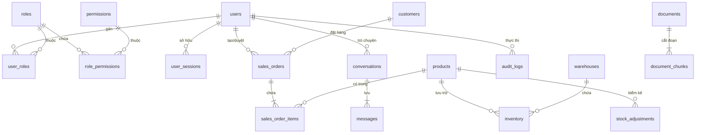

# Database Evolution Changelog & Deployment Guide

Tài liệu này ghi lại toàn bộ quá trình tiến hóa của cơ sở dữ liệu PostgreSQL trong dự án **ERP AI Copilot**, bao gồm các bảng, cột mới, ràng buộc kiểm tra (check constraints), chỉ mục (indexes), và hướng dẫn từng bước để tái hiện chính xác 100% cấu trúc cơ sở dữ liệu trên môi trường production, staging hoặc Docker/Azure.

---

## 1. Bản đồ Kiến trúc Cơ sở Dữ liệu Tổng thể

Hệ thống sử dụng **PostgreSQL 15+** với 2 extension bắt buộc:
- `pgcrypto`: Sinh UUID (`gen_random_uuid()`) và băm mật khẩu.
- `vector`: Hỗ trợ kiểu dữ liệu `vector(1536)` cho RAG Semantic Search.

Hệ thống được tổ chức thành 2 Schema độc lập:
1. **Schema `erp`**: Chứa toàn bộ nghiệp vụ lõi ERP, Quản trị Phân quyền RBAC, và Nhật ký Kiểm toán.
2. **Schema `ai`**: Quản lý Tài liệu RAG tri thức, Chunk Embedding, Phiên đàm thoại và Lịch sử tin nhắn Copilot.



---

## 2. Nhật ký Thay đổi Schema qua các Giai đoạn (Changelog)

### Ban đầu (MVP Core Schema)
- **`erp.users`**: `id`, `email`, `password_hash`, `full_name`, `role`, `is_active`, `created_at`.
- **`erp.customers`**: `id`, `code`, `name`, `email`, `status`.
- **`erp.products`**: `id`, `sku`, `name`, `unit_price`, `is_active`.
- **`erp.warehouses`**: `id`, `code`, `name`.
- **`erp.inventory`**: `id`, `product_id`, `warehouse_id`, `quantity_on_hand`, `quantity_reserved`.
- **`erp.sales_orders`**: `id`, `order_number`, `customer_id`, `status` (`draft`, `pending_approval`, `confirmed`), `total_amount`, `created_by`, `created_at`.
- **`erp.sales_order_items`**: `id`, `order_id`, `product_id`, `quantity`, `unit_price`, `line_total`.
- **`ai.documents` & `ai.document_chunks`**: RAG Knowledge base với pgvector.

---

### Giai đoạn 1 (Phase 1: Quản lý Kho & Vận chuyển Đơn hàng)
* **File di trú:** [`scripts/migrate_phase1.py`](file:///d:/PROJECTS/erp-ai-copilot/scripts/migrate_phase1.py)
* **Thay đổi chi tiết:**
  1. **Bảng `erp.stock_adjustments` (Mới):** Lưu vết mọi lần kiểm kê điều chỉnh kho thực tế:
     - `delta_quantity`, `quantity_before`, `quantity_after`, `reason`, `adjusted_by`.
  2. **Ràng buộc `erp.sales_orders.status`:**
     - Mở rộng thêm trạng thái `delivered` (Giao hàng thành công) vào ràng buộc check.
     - Enum hợp lệ: `('draft', 'pending_approval', 'confirmed', 'cancelled', 'delivered')`.

---

### Giai đoạn 2 (Phase 2: Quản trị Tài chính & Hạn mức Khách hàng)
* **File di trú:** [`scripts/migrate_phase2.py`](file:///d:/PROJECTS/erp-ai-copilot/scripts/migrate_phase2.py)
* **Thay đổi chi tiết:**
  1. **Bổ sung cột vào `erp.customers`:**
     - `credit_limit NUMERIC(14, 2)`: Hạn mức tín dụng được phép nợ (Mặc định: 50.000.000 VNĐ).
     - `current_debt NUMERIC(14, 2)`: Dư nợ hiện tại của khách hàng (Mặc định: 0 VNĐ).
     - `phone VARCHAR(30)`: Số điện thoại liên hệ chính thức.
     - `address TEXT`: Địa chỉ giao dịch / kho nhận hàng.

---

### Giai đoạn 3 (Phase 3: Doanh nghiệp Hóa Phân quyền Đa tầng RBAC)
* **Cập nhật Model & Schema:**
  1. **Bảng `erp.roles` (Mới):** Quản lý vai trò chuẩn (`admin`, `director`, `sales_manager`, `sales_rep`, `warehouse_keeper`).
  2. **Bảng `erp.permissions` (Mới):** 21 quyền hạn nguyên tử theo module (`orders`, `customers`, `products`, `inventory`, `reports`, `documents`, `users`, `roles`).
  3. **Bảng `erp.role_permissions` & `erp.user_roles` (Mới):** Ma trận quan hệ nhiều - nhiều giữa người dùng, vai trò và quyền.
  4. **Bảng `erp.user_sessions` (Mới):** Quản lý phiên đăng nhập, JWT Refresh Token Rotation (`refresh_token_hash`, `user_agent`, `ip_address`, `expires_at`, `is_revoked`).
  5. **Mở rộng `erp.users`:**
     - `phone VARCHAR(30)`
     - `department VARCHAR(100)`
     - `job_title VARCHAR(100)`
     - `is_superuser BOOLEAN DEFAULT FALSE`
     - `last_login_at TIMESTAMPTZ`
     - `updated_at TIMESTAMPTZ`

---

### Giai đoạn 4 (Phase 4: Audit Logs & Tuân thủ An ninh)
* **File di trú:** [`scripts/migrate_phase4_audit_and_crud.py`](file:///d:/PROJECTS/erp-ai-copilot/scripts/migrate_phase4_audit_and_crud.py)
* **Thay đổi chi tiết:**
  1. **Mở rộng bảng `erp.audit_logs`:**
     - `actor_email VARCHAR(255)`: Email nhân viên thực hiện thao tác (tránh mất vết khi user bị xóa).
     - `actor_role VARCHAR(50)`: Vai trò tại thời điểm thực hiện hành vi.
     - `ip_address VARCHAR(45)`: Địa chỉ IP của client gọi API.
     - `details JSONB`: Chi tiết tham số payload hoặc diff dữ liệu thay đổi trước/sau.
     - Chỉ mục `idx_audit_logs_action`, `idx_audit_logs_created_at`.
  2. **Bổ sung quyền `audit:read`:** Cấp quyền tra cứu nhật ký kiểm toán cho tài khoản Quản trị viên (`admin`).

---

### Mở rộng CRUD Nghiệp vụ (CRUD Expansion)
* **Thay đổi chi tiết:**
  1. **Mở rộng bảng `erp.products`:**
     - `cost_price NUMERIC(14, 2) NOT NULL DEFAULT 0.00`: Giá vốn nhập hàng (COGS) dùng tính Gross Margin.
     - Ràng buộc: `CONSTRAINT check_product_cost_price CHECK (cost_price >= 0)`.
  2. **Ràng buộc `erp.sales_orders`:**
     - Đảm bảo trạng thái `cancelled` (Hủy đơn hàng) được kiểm tra hợp lệ và liên kết hoàn trả tồn kho dự lưu `quantity_reserved`.
  3. **Đồng bộ Permission:**
     - Đảm bảo 4 mã quyền thao tác CRUD nghiệp vụ: `customers:write`, `products:write`, `orders:cancel`, `audit:read`.

---

### Phase 5: Thu tiền Bán hàng & Điều chuyển Kho Nội bộ (Payments & Stock Transfers)
* **Thời gian thực hiện:** 17/10/2026
* **Mục tiêu:** Hoàn thiện luồng thu tiền mặt/chuyển khoản, tự động cấn trừ công nợ khách hàng và điều chuyển cân đối tồn kho liên chi nhánh (HN ↔ HCM).
* **Thay đổi chi tiết:**
  1. **Bảng `erp.payments`:**
     - `payment_number VARCHAR(50) UNIQUE NOT NULL`: Mã phiếu thu (VD: `PAY-202610-001`).
     - `customer_id UUID NOT NULL REFERENCES erp.customers(id)`: Khách hàng thanh toán.
     - `order_id UUID REFERENCES erp.sales_orders(id)`: Đơn hàng liên quan (tùy chọn).
     - `amount NUMERIC(14, 2) NOT NULL CHECK (amount > 0)`: Số tiền thu.
     - `payment_method VARCHAR(30) DEFAULT 'bank_transfer'`: Phương thức (tiền mặt / chuyển khoản).
     - `reference_code VARCHAR(100)`: Mã giao dịch ngân hàng / hóa đơn.
     - `note TEXT`: Ghi chú thu tiền.
     - `received_by UUID NOT NULL REFERENCES erp.users(id)`: Nhân viên ghi nhận.
     - `created_at TIMESTAMPTZ DEFAULT NOW()`
  2. **Bảng `erp.stock_transfers`:**
     - `transfer_number VARCHAR(50) UNIQUE NOT NULL`: Mã phiếu chuyển (VD: `TRF-202610-001`).
     - `source_warehouse_id UUID REFERENCES erp.warehouses(id)`: Kho xuất hàng.
     - `target_warehouse_id UUID REFERENCES erp.warehouses(id)`: Kho nhập hàng.
     - `product_id UUID REFERENCES erp.products(id)`: Sản phẩm điều chuyển.
     - `quantity INTEGER NOT NULL CHECK (quantity > 0)`: Số lượng chuyển.
     - `reason TEXT NOT NULL`: Lý do điều chuyển (cân đối kho, chi nhánh thiếu hàng).
     - `transferred_by UUID REFERENCES erp.users(id)`: Người thực hiện.
  3. **Đồng bộ Permission:**
     - `payments:read`, `payments:create`, `inventory:transfer`.
     - Phân quyền cho `admin`, `sales_manager`, `warehouse_keeper`.

---

### Phase 6: Phân hệ Mua hàng & Quản lý Nhà cung cấp (Purchasing & Suppliers)
* **File di trú:** [`scripts/migrate_phase6_purchasing.py`](file:///d:/PROJECTS/erp-ai-copilot/scripts/migrate_phase6_purchasing.py)
* **Thời gian thực hiện:** 17/10/2026
* **Mục tiêu:** Quản lý danh mục nhà cung cấp, lập đơn đặt mua hàng (Purchase Order) và nhập kho hàng loạt tự động tăng tồn kho thực tế (`quantity_on_hand`).
* **Thay đổi chi tiết:**
  1. Bảng `erp.suppliers`: `code`, `name`, `tax_code`, `contact_email`, `phone`, `address`, `status`.
  2. Bảng `erp.purchase_orders`: `po_number`, `supplier_id`, `warehouse_id`, `status` (`draft`, `ordered`, `received`, `cancelled`), `total_amount`, `notes`, `created_by`.
  3. Bảng `erp.purchase_order_items`: `purchase_order_id`, `product_id`, `quantity`, `unit_price`, `line_total`.
  4. Quyền hạn: `purchasing:read`, `purchasing:create`, `purchasing:receive`, `purchasing:cancel`.

---

### Phase 7: Cải tiến Bóc tách Đơn hàng & Cơ chế Chờ giao (Order Ingestion Revamp & Backorder)
* **File di trú:** [`scripts/migrate_phase7_order_ingestion_revamp.py`](file:///d:/PROJECTS/erp-ai-copilot/scripts/migrate_phase7_order_ingestion_revamp.py)
* **Thời gian thực hiện:** 17/10/2026
* **Mục tiêu:** Khử mâu thuẫn nghiệp vụ bóc tách tài liệu AI: Chống trùng lặp số PO của đối tác, tôn trọng giá thỏa thuận trên PO và hỗ trợ đơn hàng chờ giao (Backorder) khi thiếu tồn kho.
* **Thay đổi chi tiết:**
  1. **Bảng `erp.sales_orders`:**
     - `customer_po_number VARCHAR(100)`: Số đơn đặt hàng của đối tác (dùng để đối chiếu và chống nạp trùng đơn).
     - Chỉ mục `idx_sales_orders_customer_po`.
  2. **Bảng `erp.sales_order_items`:**
     - `catalog_price NUMERIC(14, 2)`: Giá niêm yết trong danh mục DB tại thời điểm tạo đơn (so sánh với `unit_price` thỏa thuận để phát hiện lệch giá).
     - `allocated_quantity INTEGER NOT NULL DEFAULT 0`: Số lượng đã được giữ chỗ trong kho sẵn sàng giao.
     - `backorder_quantity INTEGER NOT NULL DEFAULT 0`: Số lượng thiếu cần chờ nhập hàng về (liên kết đề xuất PO mua hàng).


---

### Phase 6: Quản lý Mua hàng & Nhà cung cấp (Purchasing & Suppliers)
* **Thời gian thực hiện:** 17/10/2026
* **Mục tiêu:** Mở rộng phân hệ Mua hàng (PO), quản lý danh sách nhà cung cấp (Suppliers), hoàn thiện chuỗi cung ứng khép kín: Mua hàng -> Nhập kho -> Bán hàng -> Xuất kho.
* **Thay đổi chi tiết:**
  1. **Bảng `erp.suppliers`:**
     - Quản lý nhà cung cấp hàng hóa vật tư: `code`, `name`, `tax_code`, `contact_email`, `phone`, `address`, `status`.
  2. **Bảng `erp.purchase_orders`:**
     - Quản lý đơn mua hàng: `po_number`, `supplier_id`, `warehouse_id`, `status` (`draft`, `ordered`, `received`, `cancelled`), `total_amount`, `notes`, `created_by`.
  3. **Bảng `erp.purchase_order_items`:**
     - Chi tiết mặt hàng đặt mua: `po_id`, `product_id`, `quantity`, `unit_price`, `line_total`.
  4. **Nghiệp vụ Tự động Tăng tồn kho khi Nhận hàng (PO Receiving):**
     - Khi PO chuyển sang `received`, hệ thống tự động cộng `quantity_on_hand` vào kho tương ứng và ghi AuditLog `PO_RECEIVED`.
  5. **Đồng bộ Permission:**
     - `purchasing:read`, `purchasing:create`, `purchasing:receive`, `purchasing:cancel`.
     - Phân quyền cho `admin`, `warehouse_keeper`, `sales_manager`, `director`.

---

## 3. Hướng dẫn Tái hiện Môi trường Cơ sở Dữ liệu khi Deploy

### Lựa chọn 1: Dùng Unified Migration Script (Khuyên dùng khi cập nhật DB đang chạy)
Nếu database của bạn đã có dữ liệu hoặc đã chạy từ các bản trước, hãy chạy tập lệnh điều phối duy nhất:
```bash
# Đứng tại thư mục backend (với môi trường venv đã kích hoạt):
python ../scripts/migrate_all.py
```
> Tập lệnh này được thiết kế **idempotent (chạy nhiều lần an toàn)** bằng cách sử dụng `IF NOT EXISTS` và `ON CONFLICT DO NOTHING`.

---

### Lựa chọn 2: Dựng mới Database hoàn chỉnh từ đầu (Fresh Install)
Khi khởi tạo môi trường mới tinh (Local Docker, Cloud Database mới), thực hiện 3 bước:

#### Bước 2.1: Khởi tạo bảng và nạp dữ liệu mẫu Demo
```bash
cd backend
python ../scripts/seed_demo_data.py
```
Lệnh này sẽ tự động:
- Cài đặt Extensions `pgcrypto`, `vector`.
- Sinh toàn bộ bảng theo SQLAlchemy ORM.
- Nạp 5 vai trò chuẩn RBAC, 21 quyền hạn, 5 tài khoản mẫu, danh mục kho hàng, khách hàng có hạn mức công nợ, sản phẩm có giá vốn và các đơn hàng mẫu.

#### Bước 2.2: Nạp tài liệu tri thức mẫu cho RAG Semantic Search
```bash
python ../scripts/generate_sample_documents.py
```
Tập lệnh sẽ chunking và tính toán vector embedding đưa vào `ai.documents` và `ai.document_chunks`.

---

### Lựa chọn 3: Sử dụng tệp DDL thuần SQL (Native PostgreSQL Import)
Nếu triển khai thông qua DBA hoặc công cụ quản trị SQL (pgAdmin, DBeaver, Azure Portal, Docker Compose init entrypoint):
- File SQL tổng hợp hoàn chỉnh nằm tại: [`infrastructure/schema-full.sql`](file:///d:/PROJECTS/erp-ai-copilot/infrastructure/schema-full.sql)
- Lệnh thực thi qua psql:
```bash
psql -h <host> -U <user> -d <database_name> -f infrastructure/schema-full.sql
```

---

## 4. Bảng Kiểm tra Tính Toàn vẹn (Integrity Checklist)

Sau khi deploy, chạy câu lệnh SQL sau để kiểm tra nhanh các cột quan trọng đã hiện diện đầy đủ:

```sql
SELECT table_name, column_name, data_type 
FROM information_schema.columns 
WHERE table_schema = 'erp' 
  AND (
    (table_name = 'products' AND column_name = 'cost_price') OR
    (table_name = 'customers' AND column_name IN ('credit_limit', 'current_debt', 'phone', 'address')) OR
    (table_name = 'audit_logs' AND column_name IN ('actor_email', 'actor_role', 'ip_address', 'details')) OR
    (table_name = 'users' AND column_name IN ('phone', 'department', 'job_title', 'is_superuser'))
  )
ORDER BY table_name, column_name;
```

Kết quả kỳ vọng: Đầy đủ **12 bản ghi** tương ứng với 12 trường cấu trúc mở rộng.
